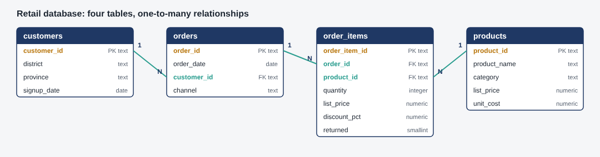
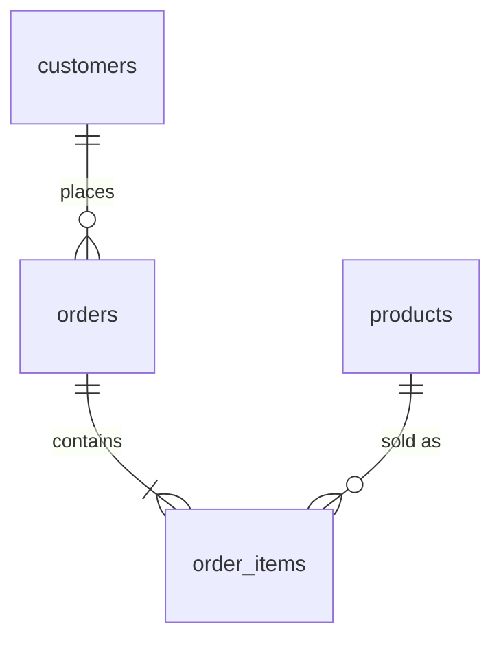

# SQL Customer & Sales Analysis (PostgreSQL)

Six business questions answered in SQL against a small PostgreSQL database, with checks that prove the numbers are right.

> **Demonstration project.** The data is synthetic (the same online-retail dataset used in my dashboard and data quality projects).



## The problem

A business has its transaction data in a database but needs reliable answers about its best customers, repeat buying, sales trends, product pairings, lapsed customers, and category performance. The risk with sales SQL is not syntax, it is silent errors: a join that repeats rows and quietly inflates revenue.

## The six questions

| # | Question | Techniques | File |
|---|---|---|---|
| 1 | Which customers generate the most revenue? | CTE, `RANK()`, share of total with a window | `q1_top_customers.sql` |
| 2 | What percentage of customers make another purchase? | `ROW_NUMBER()`, `FILTER`, `PERCENTILE_CONT` | `q2_repeat_customers.sql` |
| 3 | How does monthly revenue change? | `LAG()`, moving average, year-over-year | `q3_monthly_revenue.sql` |
| 4 | Which products are bought together? | Distinct-pair self-join, support and lift | `q4_bought_together.sql` |
| 5 | Which customers have become inactive? | `LEFT JOIN`, rule-based segments | `q5_inactive_customers.sql` |
| 6 | Which categories contribute the most revenue? | Cumulative share, gross margin | `q6_category_revenue.sql` |

Each file starts with a comment explaining the question, the definitions used, and any pitfall avoided. Results are in `results/` and the written conclusions are in [FINDINGS.md](FINDINGS.md).

## How I know the numbers are right

| Check | Result |
|---|---|
| The order-line view has the same number of rows as the order-lines table, so its joins add no rows | 7,447 = 7,447 |
| Revenue summed directly, by customer, by month, by category and by channel | All Rs 54,450,015 |
| Monthly order counts add up to the total order count | 4,111 = 4,111 |
| Gross sales - discounts - returned value = revenue | Exact |
| Every query result recomputed in pandas from the raw CSVs, with no SQL | All six match |

`sql/03_reconciliation.sql` also includes a **deliberately wrong query** to show the danger: joining each order line to all lines of its order overstates revenue by 120% and the order count by 266%.

`verification/verify_with_pandas.py` is the independent check. I confirmed it fails when a single figure is changed by one rupee.

## Key definitions

- **Revenue** = quantity x list price x (1 - discount), on lines that were not returned. Returned lines are fully refunded.
- **Purchase** = an order with at least one kept line.
- **Active / at risk / inactive** = last purchase within 90 days / 91 to 180 days / more than 180 days before the as-of date (31 December 2025). Change the thresholds at the top of `q5_inactive_customers.sql`.

## Run it

You need PostgreSQL 12 or later (for `psql --csv`) and Python with pandas for the verification step.

**Windows (Command Prompt), from the project folder:**

```
set PGUSER=postgres
set PGPASSWORD=your_password
run_all.bat
```

If `psql` is not recognised, add PostgreSQL's `bin` folder (for example `C:\Program Files\PostgreSQL\16\bin`) to your PATH, or run the commands below from the SQL Shell.

**Step by step**, run from the project root because the load script uses relative paths:

```
psql -U postgres -c "CREATE DATABASE retail"
psql -U postgres -d retail -f sql/01_schema.sql
psql -U postgres -d retail -f sql/02_load.sql
psql -U postgres -d retail -f sql/queries/q1_top_customers.sql
psql -U postgres -d retail -f sql/03_reconciliation.sql
python verification/verify_with_pandas.py
```

**Linux or macOS:** `sh run_all.sh`

## Tested on

PostgreSQL 16 on Linux, end to end, including a clean rebuild from `run_all.sh`. `run_all.bat` follows the same steps but has not been run on Windows, so if it fails, use the step-by-step commands above.

## Data model



Constraints are enforced in the database: primary and foreign keys, positive quantities and prices, discount between 0 and 1, and an allowed list of channels.

## Known limitations

- The data is random by construction, so some results (a 98.6% repeat rate, no real product affinity) are not what a real shop would show. The queries are the point, and they run unchanged on real data.
- The as-of date and the inactivity thresholds are written into the queries rather than passed as parameters.
- Products bought together counts pairs, not larger combinations of three or more.

## Layout

```
sql/01_schema.sql          tables, constraints, indexes, line-level view
sql/02_load.sql            loads the CSV files
sql/queries/               the six queries
sql/03_reconciliation.sql  accuracy checks and the fan-out demonstration
data/                      the four CSV tables
results/                   query outputs (CSV)
verification/              independent pandas check
screenshots/               diagram and one image per query
run_all.bat / run_all.sh   rebuild, run, verify
```
